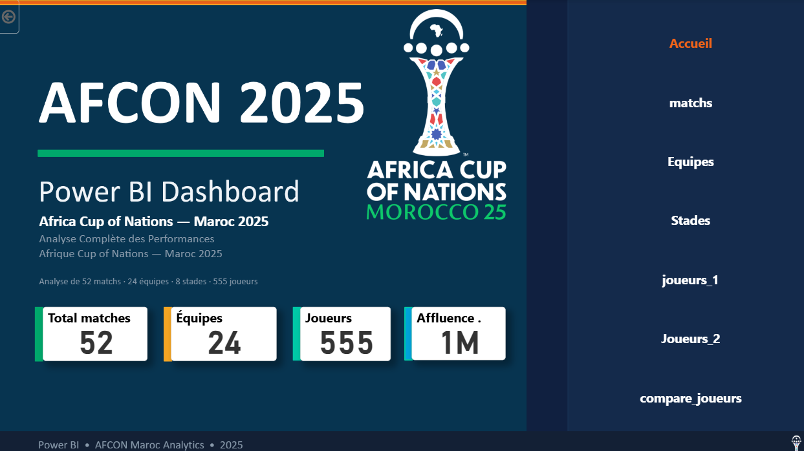
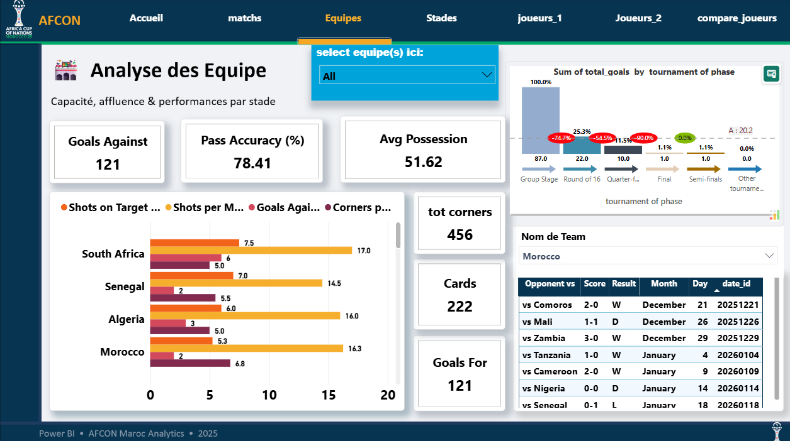
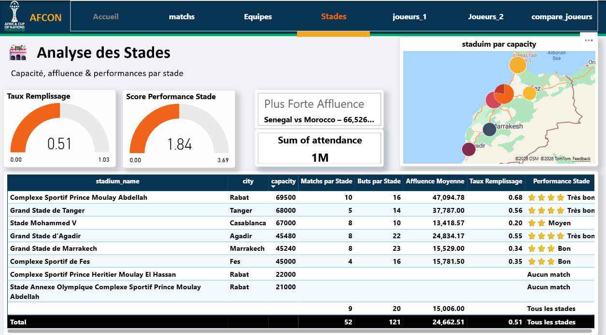
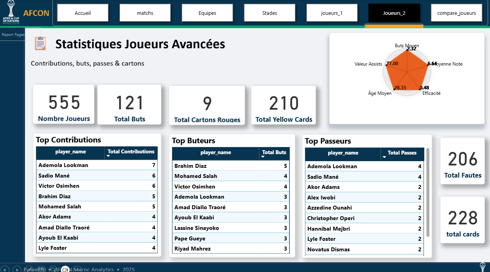
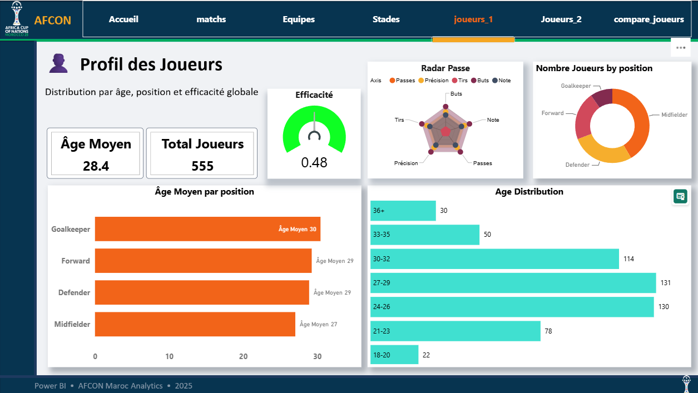
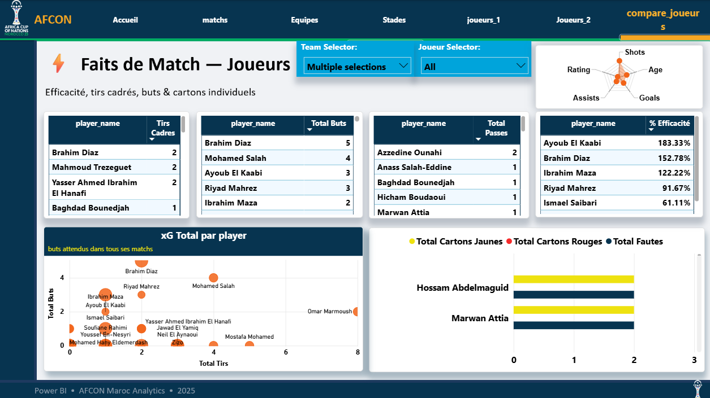
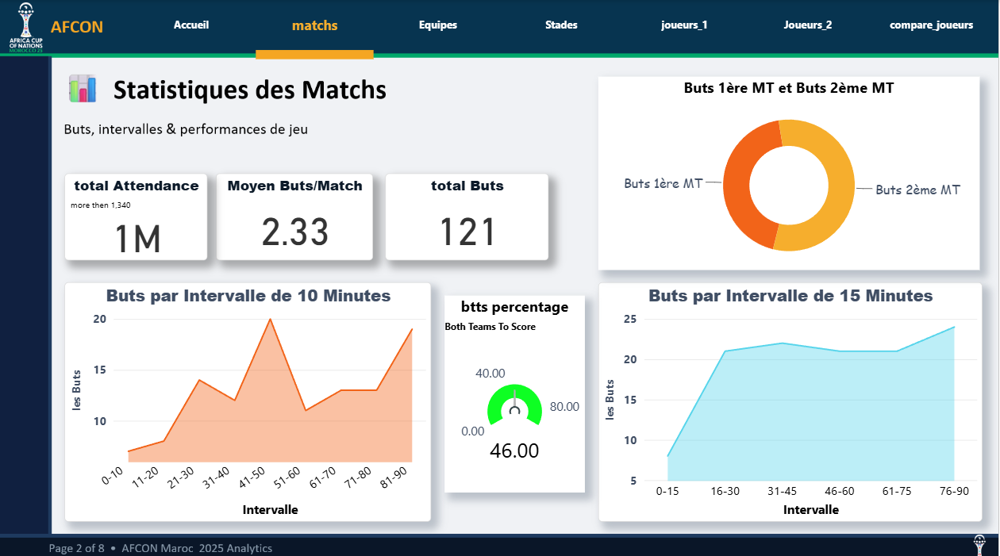

\# ⚽ AFCON 2025 - Business Intelligence \& Data Warehouse


A complete Business Intelligence (<bdi>BI</bdi>) decision-making system based on the \*\*\*Africa Cup of Nations (AFCON) 2025\*\*\* tournament hosted in <bdi>Morocco</bdi>. This project covers the entire <bdi>BI</bdi> value chain: from raw data extraction to interactive visualization.

## 📊 Power BI Dashboard Preview

Here is a visual overview of the interactive <bdi>Power BI</bdi> dashboard pages for the <bdi>AFCON 2025</bdi> tournament:

| Home Page (<bdi>Accueil</bdi>) | 
| :---: | 
|  | 

| Teams Comparison (<bdi>Équipes</bdi>) | Stadiums & Venues (<bdi>Stades</bdi>) |
| :---: | :---: |
|  |  |

| Players Statistics - Part 1 | Players Statistics - Part 2 |
| :---: | :---: |
|  |  |

| Player Comparison Analysis |Matchs Analysis (<bdi>Matchs</bdi>) |
| :---: |:---: |
|  | |

\---


\## 🛠️ Tech Stack \& Architecture


\* \*\*Data Sources:\*\* <bdi>CSV</bdi> files (Match statistics, teams, and players of AFCON 2025).

\* \*\*ETL Tool:\*\* <bdi>Talend Open Studio</bdi> (Data transformation pipelines, multiple lookups, and staging).

\* \*\*Database (DW):\*\* <bdi>MySQL 8.0</bdi> (Star Schema design with dimensional modeling).

\* \*\*Visualization:\*\* <bdi>Microsoft Power BI Desktop</bdi> (Interactive dashboard with advanced <bdi>DAX</bdi> measures).


\---


\## 📂 Repository Structure


\* `DataSets (csv)/` : Contains the raw data source files.

\* `Base de donnee (DW)/` : SQL scripts and database backup for the Data Warehouse.

\* `ETL (Talend)/` : Talend jobs and workflow documentation.

\* `Visualisation de Power BI.pbix` : The main interactive Power BI dashboard.


\---


## ⚙️ Processus ETL (<bdi>Talend Open Studio</bdi>)

Here are the data extraction, transformation, and loading (<bdi>ETL Pipeline</bdi>) stages built with <bdi>Talend</bdi>:

| Step 1: Extraction & Connection | Step 2: Transformation & Lookups |
| :---: | :---: |
| /talend_job1.png) | /talend_job2.png) |

| Step 3: Data Mapping | Step 4: Staging into DW |
| :---: | :---: |
| /talend_job3.png) | /talend_job4.png) |

| Step 5: Validation & Output | Step 6: Final Pipeline |
| :---: | :---: |
| /talend_job5.png) | /talend_job6.png) |


\---


\## 📊 Power BI Dashboard Features


1\. \*\*Home Page:\*\* Tournament overview and global KPIs.

2\. \*\*Matches:\*\* Goal analysis by time intervals (10 and 15 min), attendance, and match stats.

3\. \*\*Teams:\*\* Collective performance comparison via dynamic slicers.

4\. \*\*Venues:\*\* Interactive mapping of Moroccan stadiums, capacity filling rates, and performance scores.

5\. \*\*Players:\*\* Demographic analysis, positions, radar charts, and leaderboards (Top Scorers, Top Assists).

6\. \*\*Player Comparison:\*\* Cross-filtering and deep-dive individual match statistics.


\---


\## 🚀 Installation \& Setup


1\. Clone the repository:

&#x20;  ```bash

&#x20;  git clone \[https://github.com/soufian-haskouk/afcon-2025-business-intelligence.git](https://github.com/soufian-haskouk/afcon-2025-business-intelligence.git)

