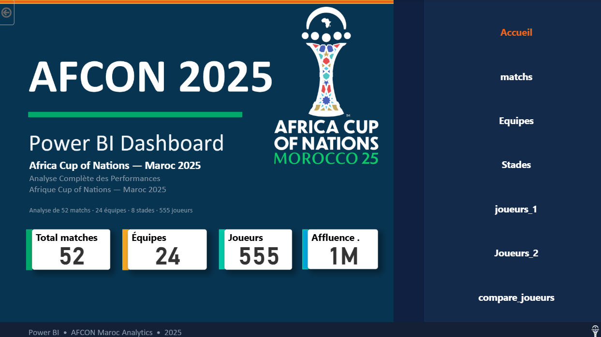
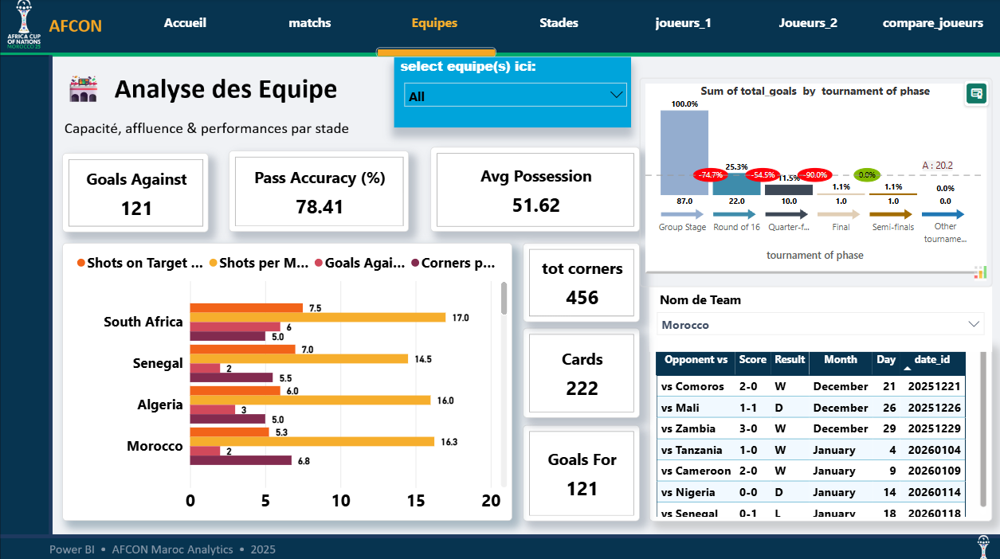
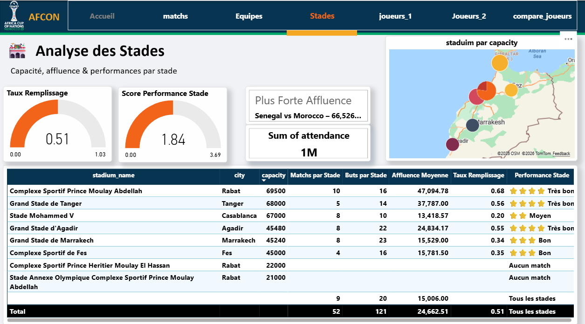
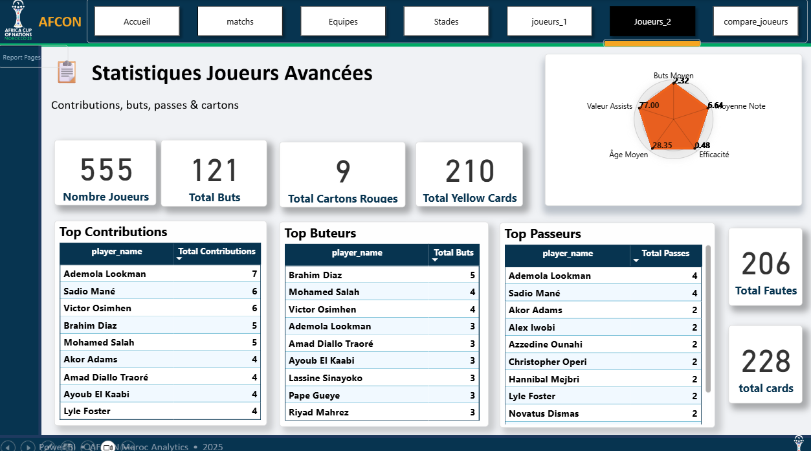
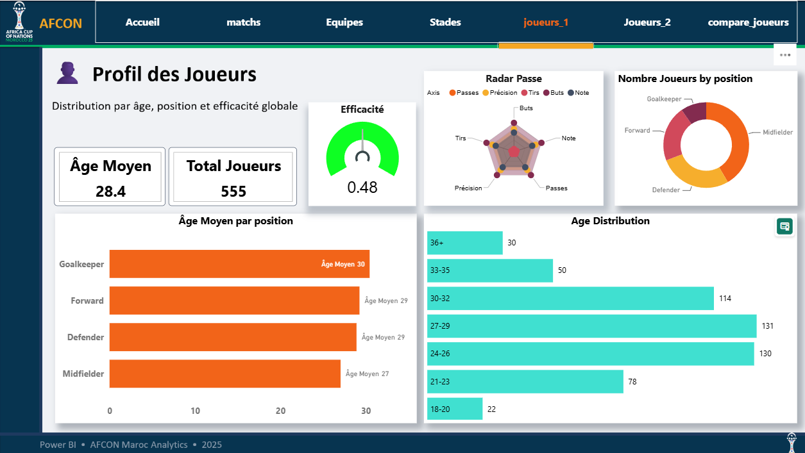
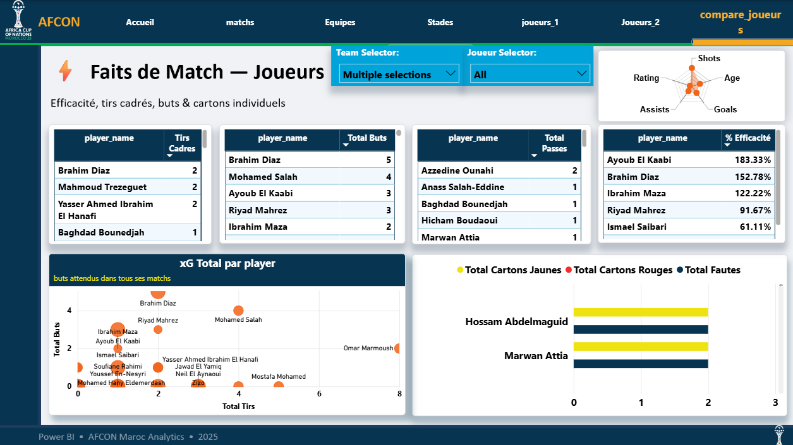
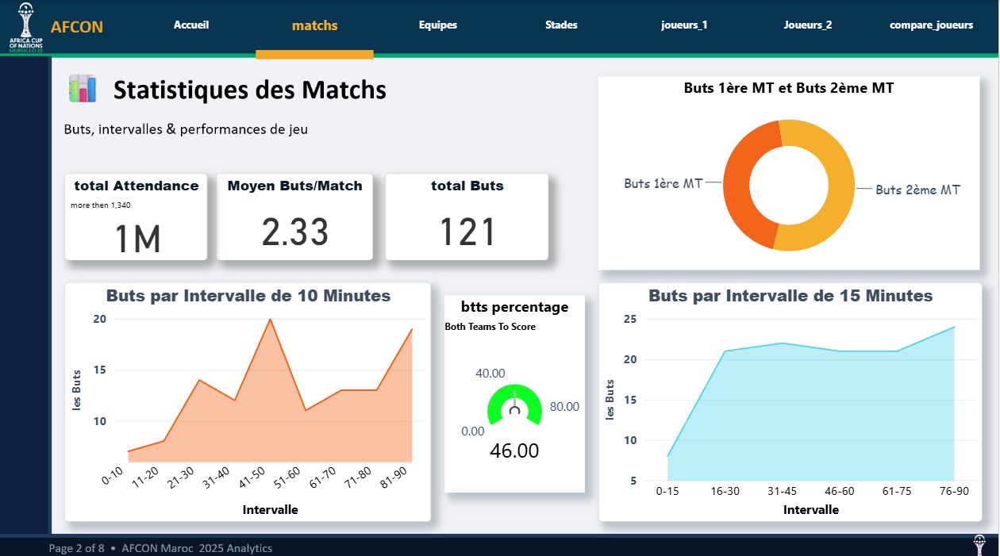
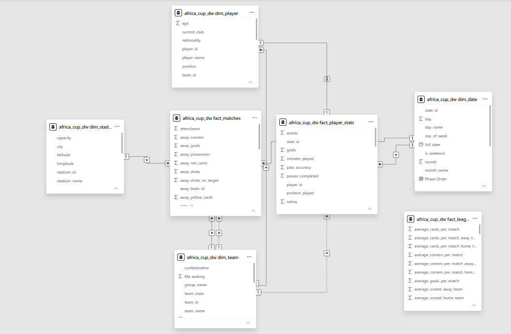

# ⚽ AFCON 2025 - Business Intelligence & Data Warehouse


> **Un système décisionnel complet de Business Intelligence (BI) basé sur la Coupe d'Afrique des Nations (AFCON) 2025 au Maroc.**

---

## 📌 Présentation du Projet
Ce projet couvre l'ensemble de la chaîne de valeur **BI** : de l'extraction des données brutes (fichiers sources CSV) jusqu'à la visualisation interactive, en passant par le traitement ETL et le stockage dans un entrepôt de données (Data Warehouse) modélisé en **Star Schema**.

---

## 📊 Aperçu du Tableau de Bord (Power BI)

Voici un aperçu visuel des différentes pages interactives du rapport **Power BI** pour le tournant **AFCON 2025** :

| Page d'Accueil (Accueil) | 
| :---: | 
|  | 

| Comparaison des Équipes (Équipes) | Stades & Lieux (Stades) |
| :---: | :---: |
|  |  |

| Statistiques des Joueurs - Partie 1 | Statistiques des Joueurs - Partie 2 |
| :---: | :---: |
|  |  |

| Analyse Comparrative des Joueurs | Analyse des Matchs (Matchs) |
| :---: | :---: |
|  |  |

---

## 📊 Architecture du Data Warehouse (Star Schema)

Schéma relationnel et modèle de données conçu pour le projet **AFCON 2025**, illustrant la structure en étoile avec les tables de faits (`fact_matches`, `fact_player_stats`, `fact_leagues`) et les dimensions (`dim_player`, `dim_team`, `dim_stadium`, `dim_date`) :



---

## 🛠️ Stack Technologique & Architecture

* **Sources de Données :** Fichiers `CSV` (Statistiques des matchs, équipes et joueurs de l'AFCON 2025).
* **Outil ETL :** `Talend Open Studio` (Pipelines de transformation, lookups multiples et staging).
* **Base de Données (DW) :** `MySQL 8.0` (Modélisation dimensionnelle en Star Schema).
* **Visualisation :** `Microsoft Power BI Desktop` (Tableau de bord interactif avec mesures DAX avancées).

---

## 📂 Structure du Dépôt (Repository)

* `DataSets (csv)/` : Fichiers sources de données brutes.
* `Base de donnee (DW)/` : Scripts SQL et sauvegarde de la base de données (Data Warehouse).
* `ETL (Talend)/` : Jobs Talend et documentation des flux.
* `Visualisation de Power BI.pbix` : Le fichier principal du tableau de bord Power BI interactif.

---

## ⚙️ Processus ETL (Talend Open Studio)

Étapes d'extraction, transformation et chargement (Pipeline ETL) construites avec Talend :

| Étape 1 : Extraction & Connexion | Étape 2 : Transformation & Lookups |
| :---: | :---: |
| /talend_job1.png) | /talend_job2.png) |

| Étape 3 : Mapping des Données | Étape 4 : Staging dans le DW |
| :---: | :---: |
| /talend_job3.png) | /talend_job4.png) |

| Étape 5 : Validation & Sortie | Étape 6 : Pipeline Final |
| :---: | :---: |
| /talend_job5.png) | /talend_job6.png) |

---

## 📊 Fonctionnalités du Tableau de Bord Power BI

1. **Page d'Accueil :** Vue d'ensemble du tournoi et indicateurs clés de performance (KPIs) globaux.
2. **Matchs :** Analyse des buts par intervalles de temps (10 et 15 min), affluence et statistiques des rencontres.
3. **Équipes :** Comparaison des performances collectives via des filtres dynamiques (slicers).
4. **Stades :** Cartographie interactive des stades au Maroc, taux de remplissage des capacités et scores de performance.
5. **Joueurs :** Analyse démographique, postes, graphiques radar et classements (Meilleurs Buteurs, Meilleurs Passeurs).
6. **Comparaison de Joueurs :** Croisement des filtres et analyse approfondie des statistiques individuelles par match.

---

## 🚀 Installation & Configuration

1. **Cloner le dépôt :**
   ```bash
   git clone [https://github.com/soufian-haskouk/afcon-2025-business-intelligence.git](https://github.com/soufian-haskouk/afcon-2025-business-intelligence.git)
